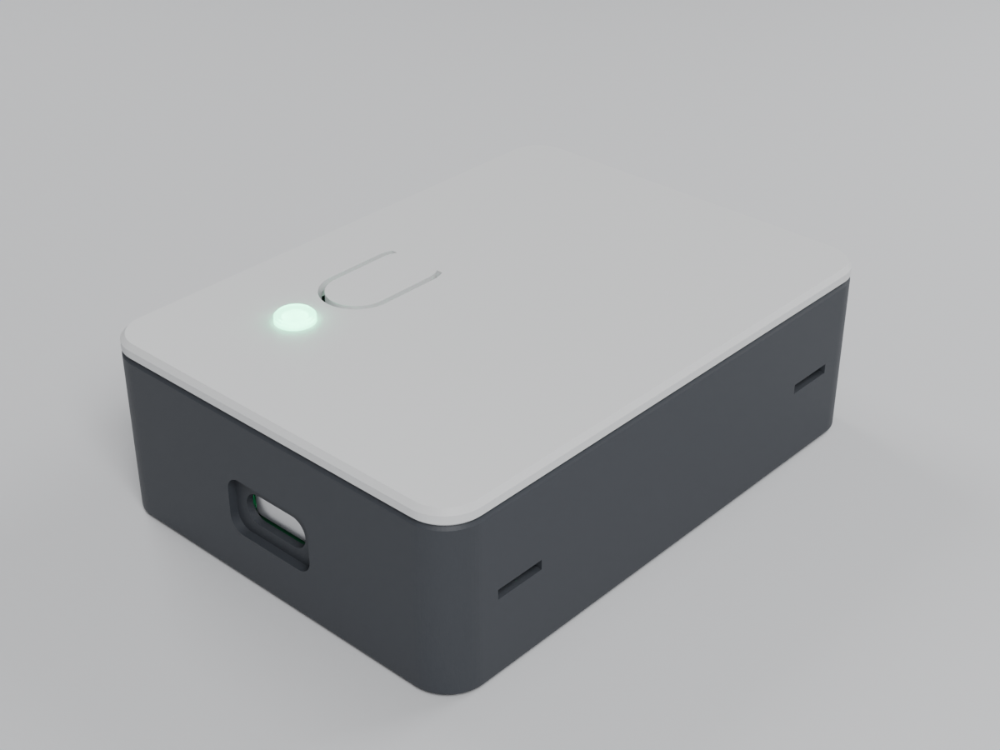
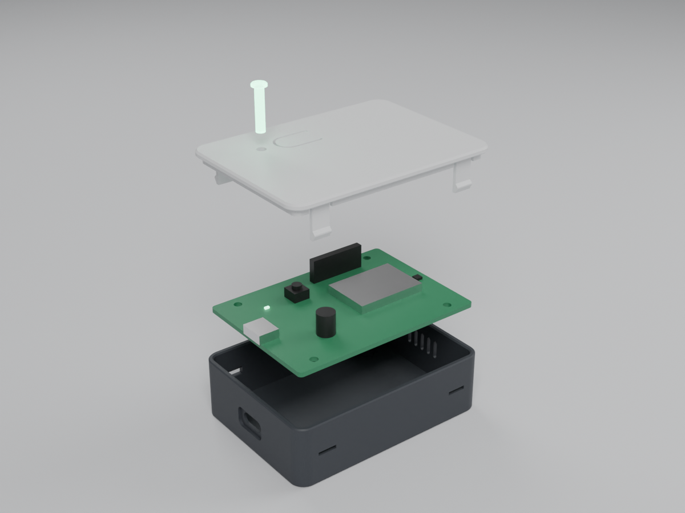
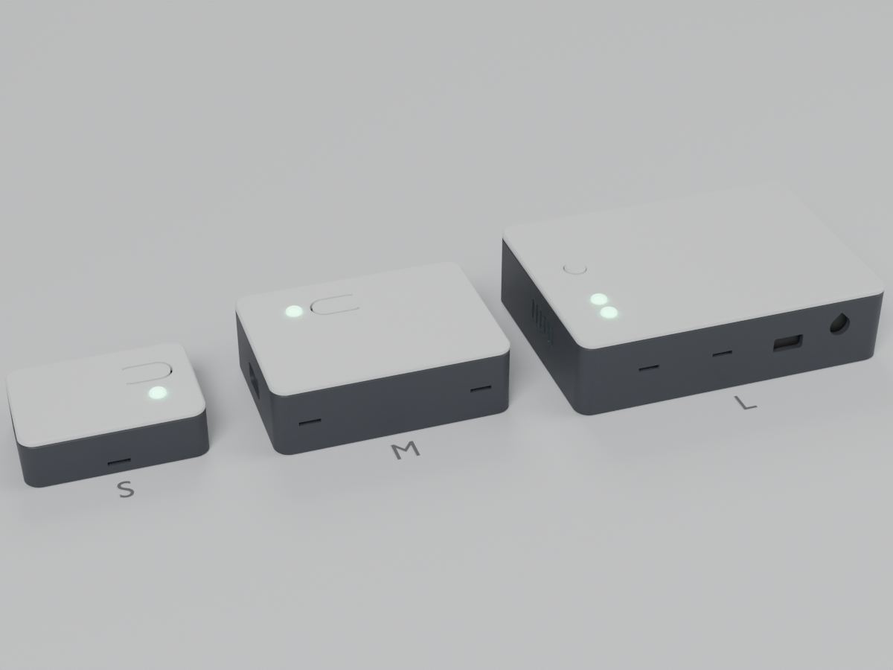
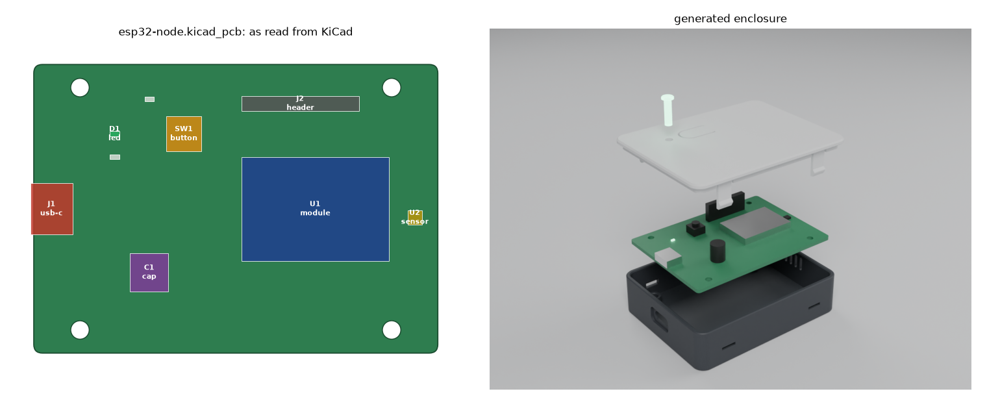
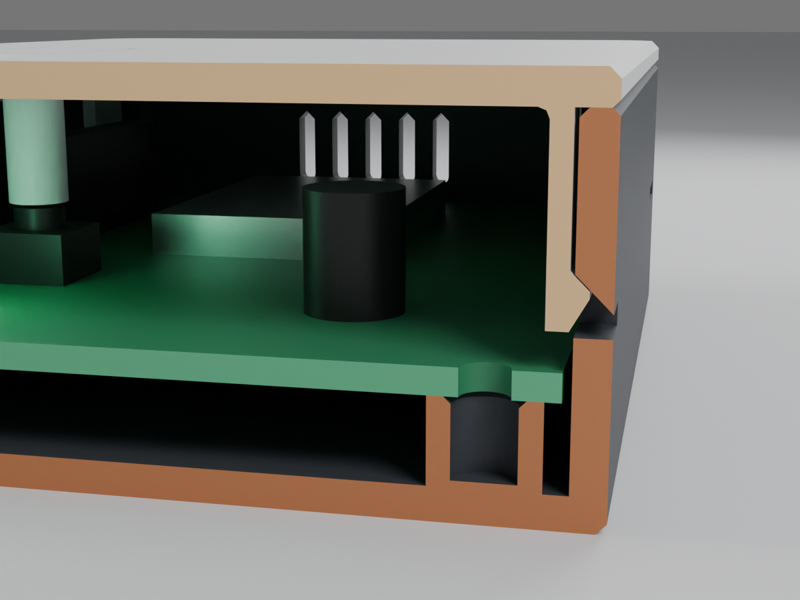
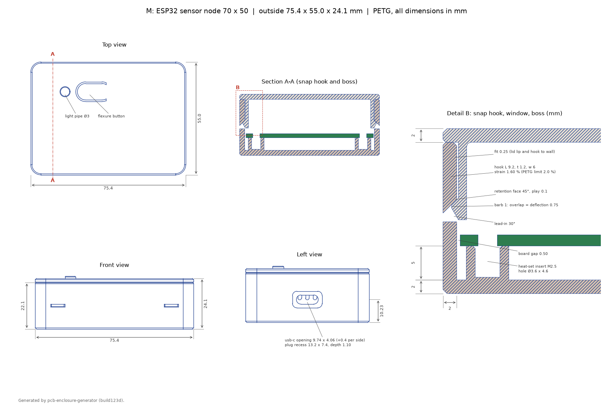

# PCB enclosure generator

[](https://github.com/sc000byd00/pcb-enclosure-generator/actions/workflows/ci.yml)



**Try it in the browser:** [enclosure configurator](https://sc000byd00.github.io/enclosure-configurator/) (form or KiCad upload, 3D preview, download; source: [enclosure-configurator](https://github.com/sc000byd00/enclosure-configurator)).

Describe a circuit board in a short YAML file, or point it at a KiCad board file, and get a 3D-printable enclosure: base with bosses for heat-set inserts, a lid with snap hooks, light pipes for the LEDs, a button that works through the lid, and cutouts that line up with the connectors. Every enclosure is checked before it is written: wall thickness, clearances, collisions with the board and its components, snap-hook strain, overhangs. Change the board and run it again; the whole enclosure follows.



## Features

- **Snap-fit lid** with cantilever hooks sized from the allowed strain, a 30° lead-in and a 45° retention face. If the hooks don't fit above the board, the cavity widens so they hang beside it.
- **Connector cutouts** for USB-C, DC barrel jack and screw terminal, with clearance on every side. Where the wall is too thick for the plug, an outside recess for the plug's overmold is added automatically.
- **Light pipes** for each LED, with a sleeve in the lid against stray light.
- **Button** as a flexure in the lid, or as a separate cap with a guide sleeve.
- **Vent slots**, **keyholes** for wall mounting, chamfers against elephant's foot.
- **Keep-out zones** (e.g. a module antenna past the board edge): the cavity grows on that side only, and a check makes sure no enclosure part enters the zone.
- **Support posts** where the board has no mounting hole.
- **Printable as oriented:** round openings get a 45° teardrop roof, vent slots a pointed top, the lid and light pipes are exported upside down.
- **KiCad input:** reads outline, mounting holes and components straight from a `.kicad_pcb` file and finds which edge each connector sticks out of.
- **Output:** STEP, STL and 3MF per part in print orientation, a check report (Markdown and JSON), and an optional dimensioned drawing.



## Quick start

```bash
pip install -e ".[drawing]"
enclosure build examples/m.yaml -o out --drawing
```

A board file:

```yaml
name: m
title: "M: ESP32 sensor node 70 x 50"

board:
  size: [70, 50]
  holes: [[8, 4], [62, 4], [8, 46], [62, 46]]
  screw: M2.5
  component_height: 12.0

components:
  - {type: usb-c, side: left, pos: 25, overhang: 0.6}
  - {type: module, x: 36, y: 16, w: 25.5, d: 18, h: 3.1}
  - {type: cap, x: 20, y: 14, dia: 6.3, h: 7.7}
  - {type: header, x: 36, y: 42, w: 20.3, d: 2.5, h: 8.5}
  - {type: vent, side: right, pos: 25, n: 5, w: 1.6, h: 7.0, pitch: 3.4}
  - {type: led, x: 14, y: 38}
  - {type: button, x: 26, y: 38, dir: "+x"}

snap_hooks:
  front: [8, 62]
  back: [8, 62]
```

Board coordinates start at the board's front left corner. Edge components (`usb-c`, `barrel`, `terminal`, `vent`) take a side and a position along that edge; everything else takes x and y. `module`, `header`, `sensor` and `cap` are there for the collision checks.

More component types:

```yaml
  - {type: keepout, x: 36, y: 2, w: 21, d: 43}   # front left corner, size; may reach past the board
  - {type: post, x: 33.8, y: 12, dia: 4}         # support under the board, no hole
  - {type: button, x: 21.5, y: 34.8, dir: "+x", switch: ts-1187a}   # 6x6 (default) or ts-1187a
```

A keep-out is a box over the full cavity height. If it reaches past an edge, the cavity on that side grows until the lid's centring lip stays outside it; the board then sits off centre.

Result in `out/m/`: `base`, `lid`, `light-pipe-1` as STEP, STL and 3MF, plus `report.md`, `checks.json` and `drawing.png`/`.pdf`. The command exits with code 1 if any check fails.

### Optional settings

All have defaults; override only what you need.

| Section | Keys |
| --- | --- |
| `board` | `thickness` (1.6), `corner_radius` (1.5), `standoff` (5.0), `screw` (M2, M2.5 or M3) |
| `shell` | `wall` (2.0), `floor` (2.0), `lid` (2.0), `corner_radius` (5.0) |
| `clearance` | `board` (0.5), `lid_fit` (0.25), `cutout` (0.4 per side), `lid_gap` (1.5) |
| `hook` | `thickness` (1.2), `width` (6.0), `barb` (1.0), `lead_angle` (30), `retention_angle` (45), `play` (0.1), `target_strain` (0.016) |
| `flexure` | `length` (12), `width` (8), `thickness` (1.2), `slot` (0.8), `gap` (0.3) |
| `cap` | `diameter` (7.0), `fit` (0.3), `proud` (1.0) |
| `light_pipe` | `diameter` (3.0), `fit` (0.1), `head_diameter` (5.0), `head_height` (1.0), `gap` (0.5), `sleeve` (3.0) |
| top level | `button` (`flex` or `cap`), `wall_mount` (keyhole x positions) |

Unknown keys, components outside the board and similar mistakes are reported with the key that caused them.

## From KiCad

```bash
enclosure from-kicad examples/kicad/esp32-node.kicad_pcb -o out --drawing
```



The board file gives the outline (rectangle, square or rounded corners), the thickness, the mounting holes (drill 2.2 → M2, 2.7 → M2.5, 3.2 → M3) and the components on the top side. Footprints are recognised by name:

| Footprint name | Becomes |
| --- | --- |
| `USB_C_Receptacle*`, `BarrelJack*`, `TerminalBlock*` | edge connector: side, position and overhang from its outline |
| `LED_0603`, `LED_0805`, ... | LED with a light pipe |
| `SW_PUSH_6mm*`, `SW_Push_1P1T_NO_6x6*` | button (flexure or cap) |
| `SW_Push_1P1T_XKB_TS-1187A` | low-profile button, 5.1 x 5.1 x 1.5 mm |
| `ESP32-*`, `RF_Module*`, ... | module, size from F.Fab |
| `PinHeader_*`, `PinSocket_*` | header (8.5 mm, or 2.5 mm horizontal) |
| `CP_Elec_6.3x7.7`, ... | capacitor, diameter and height from the name |
| 0402 to 1206 passives | ignored |
| anything else | part with its F.Fab size and 2 mm height, with a warning |

Snap hooks are placed on the front and back edges, clear of the connector openings, and the design height follows the tallest part. The result goes to `out/<name>/board.yaml` together with the enclosure, so it can be reviewed.

What the board file doesn't contain goes into an overrides file next to it, `<board>.overrides.yaml` (or `--overrides`):

```yaml
title: "Gateway (from KiCad)"
button: cap                  # any top-level key of a board file
wall_mount: [-28, 28]
ignore: [J5]                 # leave parts out
parts:
  U3: {h: 4.2}               # correct a height, a type, an edge position
add:                         # things that are not footprints
  - {type: vent, side: right, pos: 40, n: 6, w: 1.6, h: 8.0, pitch: 3.4}
board:
  standoff: 6.0
```

The two example boards in `examples/kicad/` are written by `make_boards.py` with footprints named and shaped like the KiCad library ones.

## How the snap hooks are sized

A hook is a cantilever of thickness t that bends by y while the barb slides past the wall. The strain at the root is

```
eps = 1.5 * t * y / L^2
```

The generator solves this for the length L. With t = 1.2 mm, a 1.0 mm barb minus 0.25 mm fit (y = 0.75 mm) and a target of 1.6 %, L = 9.2 mm. The limit is 2.0 % for PETG: the hooks print standing, so the bending stress runs across the layer lines and the limit stays well below the elongation at break.

The report also gives the forces. Tip force P = w · t² · E · eps / (6 · L), and the force to push the barb past the edge is P · tan(alpha + atan(mu)): about 5.3 N per hook to close (30° lead-in) and 9.3 N to open (45° retention face), with E = 2000 MPa and mu = 0.3. The 45° face holds, but is not self-locking: the lid can be pulled off with a tool through the window, without breaking a hook.



## Checks

Each build runs these checks and writes the result to `report.md` and `checks.json`:

- wall, floor and lid at least 1.6 mm; webs between openings, to the rim and to the floor at least 1.0 mm
- board fits with clearance, including the corners
- board and all components clear of every enclosure part
- tallest component within the design height, and clear of the lid, its lip, hooks and sleeves
- every plug fits its cutout with the set clearance; plug overmold fits its recess
- lid does not intersect the base
- snap-hook strain within the limit; hooks deflected by their travel plus 0.2 mm stay clear of the board and components
- flexure strain and press force, or cap travel
- light pipe distance to the LED; free space under the board above the keyholes
- overhang area in print orientation (information)

Excerpt from `out/m/report.md`:

```
PASS  board and components clear of all enclosure parts
PASS  plug-usb-c-0: plug in the cutout, 0.40 mm clearance (target 0.4)
PASS  usb-c: plug recess 1.10 mm deep, remaining wall 0.90 mm
PASS  narrowest web 2.82 mm (back hook window to corner), min 1
PASS  snap hooks: L 9.2 mm, t 1.2, deflection 0.75 mm -> strain 1.60 % (limit 2.0 %, PETG)
INFO  assembly 4 x 5.3 = 21 N, removal 4 x 9.3 = 37 N (E 2000 MPa, mu 0.3)
PASS  button flexure: L 9.0, t 1.2, travel 0.55 mm -> strain 1.22 %, press force 6.8 N
```

The tests (`pytest`) read the KiCad examples and rotated or unusual footprints, build the three examples, compare their outside dimensions, check that every exported STL is watertight, and feed in deliberately bad designs (thin wall, short hooks, a connector in a boss, a component that is too tall) to make sure the right check fails.

## Drawing

`--drawing` adds a dimensioned drawing with top, front and left view, a section through a hook and a boss, and a detail of the hook.



## Printing notes

- PETG, 0.2 mm layers. Base on its floor, lid with its top face on the bed (hooks pointing up), light pipes head down, button cap upside down. The exported files are already oriented this way.
- Light pipes in clear or natural PETG.
- Heat-set inserts go in with a soldering iron.
- Bridges in the base: top edge of the connector openings and recesses, keyhole pockets.

## Limits

- Rectangular boards with rounded corners. Components are boxes or cylinders for the collision checks.
- KiCad: top-side components only; footprints whose courtyard or F.Fab outline doesn't match the real part (some connectors) need a correction in the overrides file.
- Connector, switch and insert sizes are typical values (`enclosure/specs.py`). Check the datasheets of your parts and measure the board before printing.
- Material values for PETG are assumptions, not measurements. The images are renderings.

## Renderings

The images are rendered with Blender:

```bash
enclosure build examples/*.yaml -o out --render-meshes
blender -b --factory-startup -P render/render.py -- assembled docs/images/assembled.png m
```

Modes: `assembled`, `exploded`, `section`, `variants`.

## License

MIT, see [LICENSE](LICENSE).
